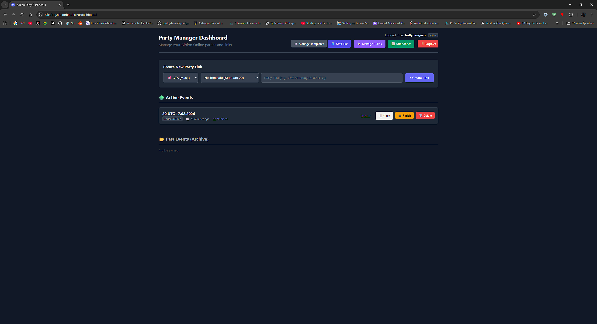
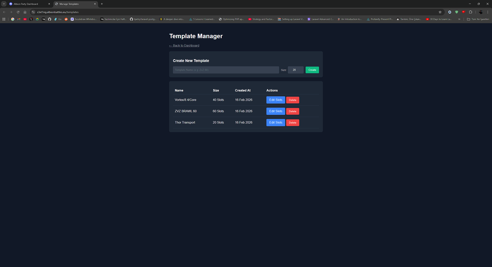
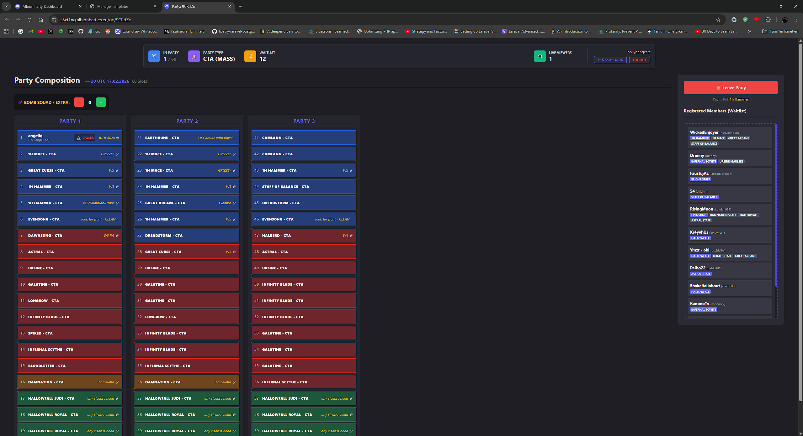
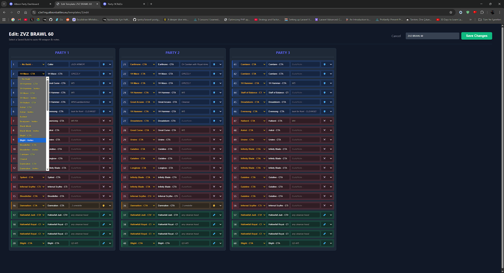
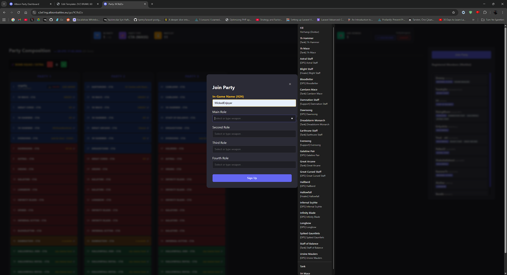
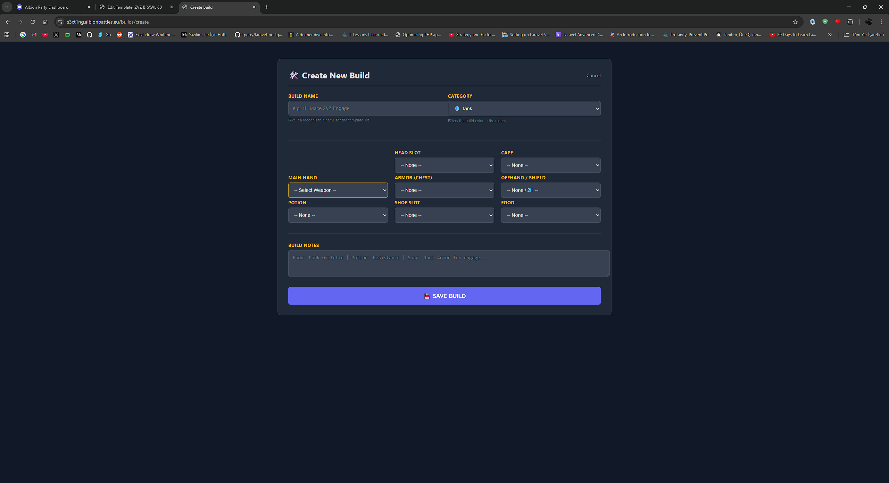
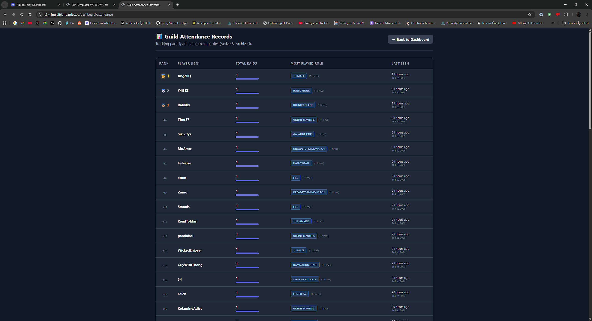

<div align="center">

# ⚔️ Albion Online Party Manager

**Web based party management tool for guilds, no need excel any more!**


</div>

---

## 🚀 Key Features

* **🛡️ Visual Roster:** Drag & drop interface for managing party slots, updated live for every viewer (Laravel Reverb).
* **✅ Role Validation:** Players register up to 4 weapons; slots are matched by weapon/build (not by fuzzy names) and mismatches are flagged.
* **📊 Role Summary:** Live "Tank 2/4 · Healer 3/5 · DPS …" overview per party.
* **💣 Dynamic Slots:** "Bomb Squad" / extra slots can be added instantly by callers.
* **⏰ Registration Window:** Each party closes sign-ups after a configurable time.
* **📊 Attendance System:** When an event is finished, placed players are checked in automatically; staff can correct it per player. Stats only count real attendance.
* **💾 Templates & Builds:** Reusable party templates, saved builds with full equipment, and "save this roster as a template".
* **🔁 Swaps & Enemy Situations:** Builds carry situational swaps (Kite / Monkey / Melee Clap / Castle / Brawl) and alternatives. The caller flips the enemy situation on the party screen and every player instantly sees what to swap.
* **📋 Briefing & Mounts:** Templates carry a briefing ("TANKS → MIN T7 SIEGE HAMMER") and battle-mount slots; builds store abilities (Q1 · W4…).
* **📥 Excel Import:** Upload your composition spreadsheet — one sheet becomes a template, each row a build (shorthand like ASAS HOOD, JUDI ARMOR, GALA, BEHE is understood).
* **💰 Regear Payouts:** After an event, deaths are pulled from the official Albion killboard, matched to the roster by IGN and compared slot by slot with the build the player should have worn (minimum tier per role). The caller reviews warnings, approves/rejects with a fixed payout per role, and gets a copyable payout list.
* **🔐 Discord Integration:** OAuth2 login restricted to members of your guild with a specific role (re-checked periodically).
* **📣 Discord Bot:** Optional announcement of new parties and "ping roster" (mentions every placed player) in a channel.

---

## 💻 Tech Stack

* **Framework:** Laravel 13 (PHP 8.5)
* **Realtime:** Laravel Reverb + Laravel Echo
* **Database:** MySQL 8.4
* **Frontend:** Blade, vanilla JS (Vite 8), Tailwind 4
* **Environment:** Docker Compose (php-fpm, nginx, reverb, queue worker, mysql, asset build)

---

## 🛠️ Local Development (Docker)

Only **Docker Desktop** is required — PHP, Composer and Node run inside containers.

```bash
git clone https://github.com/badgeekduck/albion-party-manager.git
cd albion-party-manager
cp .env.example .env          # optional, the app container does it on first start
docker compose up -d --build
```

The first start takes a minute: the `app` container installs Composer packages, generates `APP_KEY`,
runs migrations and seeds the Albion item list; the `assets` container builds the frontend.
Follow it with `docker compose logs -f app` until you see `[entrypoint] Ready`.

Open **http://localhost:8088** (change `APP_PORT` in `.env` if the port is taken).

### 🧪 Testing without a Discord application

With the default `.env` (`APP_ENV=local`, `DEV_LOGIN_ENABLED=true`, `APP_DEV_SEED=true`) you get:

* a **Dev Login** button on the home page (`/dev/login`) — log in as *Dev Admin*, *Dev Caller* or one of 8 players,
* a demo template, a demo build and two demo parties with registered players.

Use a second browser (or a private window) to log in as another user and watch the roster update live.

> Dev login only works when **both** `APP_ENV=local` and `DEV_LOGIN_ENABLED=true`. Never enable it in production.

### Useful commands

```bash
docker compose exec app php artisan test                     # run the test suite
docker compose exec app php artisan app:set-role <id|discord_id|name> admin   # admin | content-creator | user
docker compose exec app php artisan migrate                  # after pulling new migrations
docker compose run --rm assets                               # rebuild JS/CSS after frontend changes
docker compose logs -f app reverb queue
```

### Regear (killboard) setup

1. Find your guild ID: `docker compose exec app php artisan app:albion-guild "Your Guild"` and set `ALBION_GUILD_ID` (and `ALBION_REGION`: europe / americas / asia).
2. On a party, open **💰 Regear**, enter the event start/end (UTC), minimum tiers and payout per role, then **Killboard'u tara**.
   The scan runs on the queue worker (big ZvZ = many API pages) and can be repeated; decided claims are kept.
3. Notes from testing the official API: only 51 events per page; `events?guildId=` lists the guild's kills only, so deaths
   are read from battle events; spells are not exposed (ability picks can't be verified); bag, mount, potion and food are not checked/paid.

### Importing a composition spreadsheet

Builds → **📥 Import compositions from Excel** (or the CLI):

```bash
docker compose exec app php artisan app:import-roster "storage/app/private/imports/ROAD BLOCK.xlsx" --dry-run
```

Expected columns per row: `weapon | player | head | armor | shoes | offhand/swaps/tips | cape | food` (positions are detected
from the cape column). Rows without gear become the template briefing; the player column is ignored.
Swaps are read from `X->Y`, `(MONKEY->ASAS HOOD)`, `ICICLE SWAP AGAINST KITE`; `A/B` means alternatives.
Unrecognised items are kept in the build notes and listed in the import report — fix them in the build editor
or add an alias in `app/Support/Import/AlbionItemResolver.php`. Re-importing updates builds/templates in place.

Item icons are downloaded once by Albion item ID into `public/item-icons` (git-ignored) and then served by nginx.
The container warms this cache on start; you can also run `php artisan app:cache-item-icons`.
IDs live in `database/data/albion_item_ids.php` (generated from ao-data/ao-bin-dumps).

MySQL is reachable from your machine only, on `127.0.0.1:33306` (`DB_FORWARD_PORT`).

---

## 🔐 Discord Setup

1. Create an application at <https://discord.com/developers/applications>.
2. **OAuth2:** add the redirect `http://localhost:8088/auth/discord/callback` (or your domain) and copy the client ID/secret.
3. **Bot:** create a bot, copy its token and invite it to your server (it only needs to read members; for announcements also *Send Messages* in the channel).
4. Fill in `.env`:

```dotenv
DISCORD_CLIENT_ID=...
DISCORD_CLIENT_SECRET=...
DISCORD_REDIRECT_URI="${APP_URL}/auth/discord/callback"
DISCORD_GUILD_ID=...          # your server ID
DISCORD_ROLE_ID=...           # role required to log in
DISCORD_BOT_TOKEN=...
DISCORD_ANNOUNCE_CHANNEL_ID=  # optional: party announcements + roster pings
```

Login is refused (HTTP 503) if the guild check is not configured, so the site can never be open to every Discord user.
Membership is re-checked every `DISCORD_MEMBERSHIP_RECHECK_MINUTES` (default 15); users who left the guild or lost the role are logged out.

The first user to log in is a normal member — promote yourself with `php artisan app:set-role <your name> admin`.

---

## 🚢 Production notes

* `APP_ENV=production`, `APP_DEBUG=false`, `DEV_LOGIN_ENABLED=false`, `APP_DEV_SEED=false`, strong DB/Reverb secrets.
* Run `php artisan config:cache route:cache view:cache` on deploy (all settings are read through `config()`).
* Reverb is proxied by nginx on the same host under `/app` (see `docker/nginx.conf`), so it works behind HTTPS without extra ports.
  If the browser must connect elsewhere, set `REVERB_CLIENT_HOST/PORT/SCHEME`.
* Keep a queue worker running (`php artisan queue:work`) for Discord messages.
* Do not publish the MySQL port.

---

## 📂 Project Structure

* `app/Http/Controllers` — Party (roster, join, move…), Dashboard, Templates, Builds, Attendance, Auth.
* `app/Policies/SharedLinkPolicy.php` — who can manage / arrange a party.
* `app/Services/SlotAssigner.php` — slot ↔ role matching rules.
* `app/Support/PartyBoard.php` — view model for the party screen.
* `app/Services/Discord` — guild membership checks and bot messages.
* `resources/views/party` — party screen (`show`) and the live-refreshed board (`_board`).
* `resources/js/party.js` — drag & drop, live refresh, join form rules.

## 📂 Roles & Permissions

| | Member | Content Creator | Admin |
|---|:-:|:-:|:-:|
| Join / leave parties, view attendance | ✅ | ✅ | ✅ |
| Move themselves (PvP Content parties) | ✅ | ✅ | ✅ |
| Dashboard, create parties, templates & builds | | ✅ | ✅ |
| Arrange any player | | ✅ | ✅ |
| Finish / delete / extra slots / ping / attendance of a party | creator only | creator only | ✅ |

## 🤝 Contributing

1. Fork the repo and create a branch (`git checkout -b feature/amazing-feature`).
2. Run `docker compose exec app php artisan test` and `vendor/bin/pint`.
3. Commit, push and open a pull request.

## 📸 Screenshots















## Credits

- [Harun Baş](https://github.com/badgeekluck)
- [Mircea Moldo](https://github.com/mirceamoldo)

## License

This project is licensed under the [MIT License](LICENSE).
